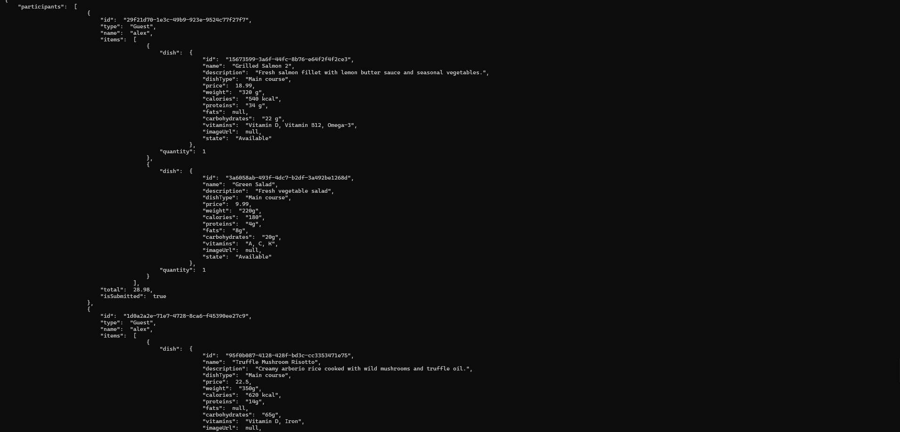
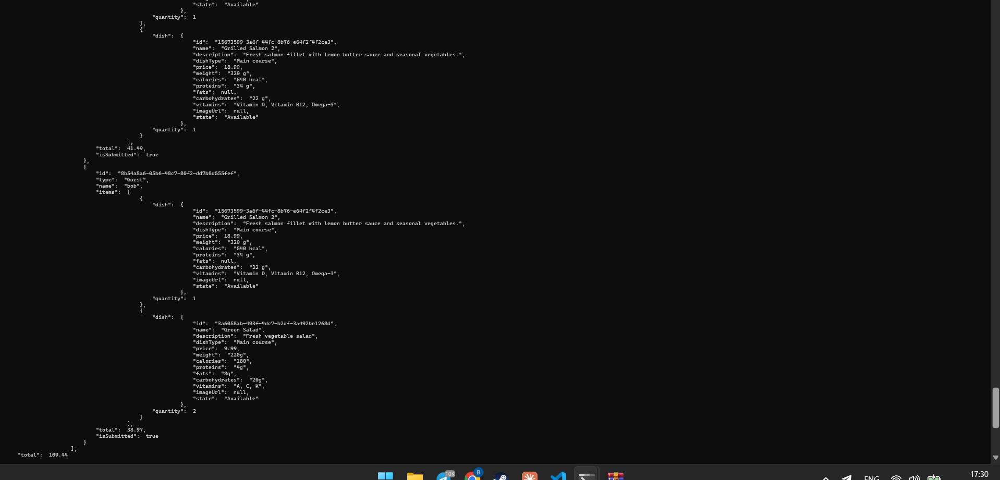
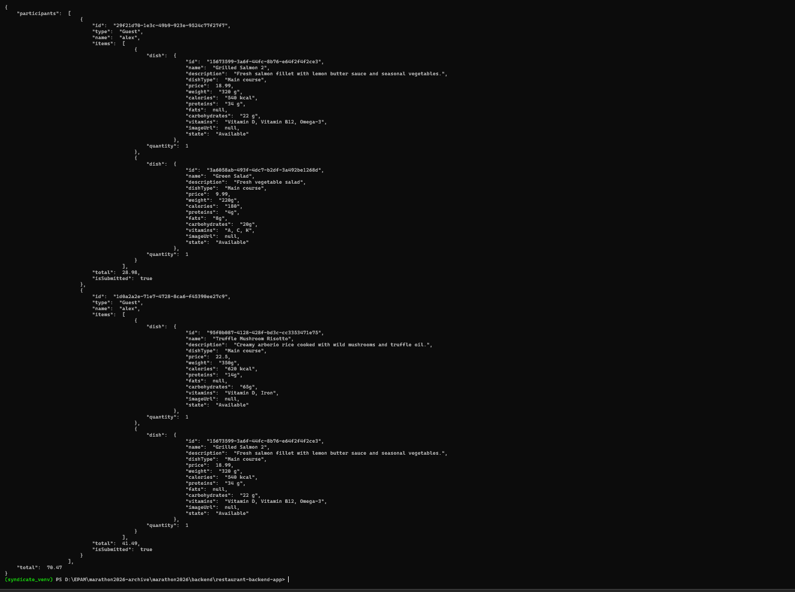
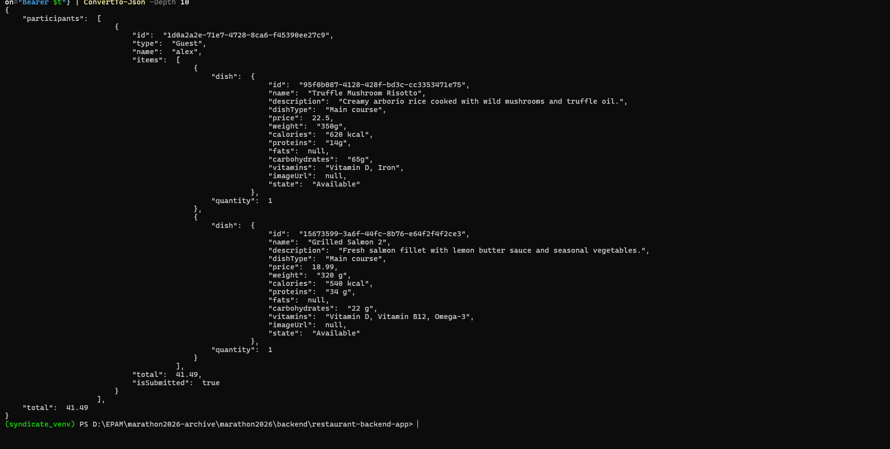

# Домашнє завдання Backend — Груповий pre-order для Owner

Виконано рівні **1** і **3**. Застосунок розгорнуто у власному AWS (Terraform → Syndicate → фронтенд на S3/CloudFront).

## Рівень 1 — `GET /guest/groups/{groupReservationId}/sessions`

Owner бачить учасників групи, їхні страви, суму по кожному учаснику і загальну суму.

**Що зроблено:**
- `Services/GuestSessions/GuestSessionService.cs` — метод `GetAllSessionAsync(userId, groupReservationId)`:
  перевірка, що запит робить власник бронювання (`ValidateReservationOwnerAsync`) → усі guest sessions групи → страви одним запитом до БД (ціна береться з БД, а не від клієнта) → учасники з сумами → загальна сума.
- `Services/GuestSessions/IGuestSessionService.cs` — оголошення методу.
- `Handlers/GuestSessions/GetAllSessionsHandler.cs` — обробник: `groupReservationId` з path, `userId` з claim `sub` токена Cognito; помилки → 400 / 401 / 403 / 404 / 500.
- `Routing/RouteRegistry.cs` — маршрут `GET /guest/groups/{groupReservationId}/sessions`.
- `deployment_resources.json` — ресурс API Gateway з `cognito_authorizer`.
- `swagger-endpoints.yaml` — опис ендпоінта.
- `Models/GuestSessions` — додано `[JsonPropertyName]`, щоб поля відповіді були camelCase, як у контракті (`participants`, `id`, `type`, `name`, `items`, `total`, `isSubmitted`).

## Рівень 3 — `DELETE /guest/groups/{groupReservationId}/sessions/{guestSessionId}`

Маршрут зареєстровано в `RouteRegistry` і `deployment_resources.json` (`cognito_authorizer`); після видалення повертається оновлений snapshot групи в тому ж форматі, що й GET.

## Перевірка

Перевірено на розгорнутому API з реальним бронюванням: Owner створив бронювання, гості зайшли за Invite Link, додали страви і підтвердили кошики. Запити виконувались з ID-токеном Owner (Cognito).

Відповідь GET (3 гості; загальна сума 109.44 = 28.98 + 41.49 + 38.97):

```json
{
  "participants": [
    {
      "id": "29f21d70-1e3c-49b9-923e-9524c77f27f7",
      "type": "Guest",
      "name": "alex",
      "items": [
        {
          "dish": {
            "id": "15673599-3a6f-44fc-8b76-e64f2f4f2ce3",
            "name": "Grilled Salmon 2",
            "description": "Fresh salmon fillet with lemon butter sauce and seasonal vegetables.",
            "dishType": "Main course",
            "price": 18.99,
            "weight": "320 g",
            "calories": "540 kcal",
            "proteins": "34 g",
            "fats": null,
            "carbohydrates": "22 g",
            "vitamins": "Vitamin D, Vitamin B12, Omega-3",
            "imageUrl": null,
            "state": "Available"
          },
          "quantity": 1
        },
        {
          "dish": {
            "id": "3a6058ab-493f-4dc7-b2df-3a492be1268d",
            "name": "Green Salad",
            "description": "Fresh vegetable salad",
            "dishType": "Main course",
            "price": 9.99,
            "weight": "220g",
            "calories": "180",
            "proteins": "4g",
            "fats": "8g",
            "carbohydrates": "20g",
            "vitamins": "A, C, K",
            "imageUrl": null,
            "state": "Available"
          },
          "quantity": 1
        }
      ],
      "total": 28.98,
      "isSubmitted": true
    },
    {
      "id": "1d0a2a2e-71e7-4728-8ca6-f45390ee27c9",
      "type": "Guest",
      "name": "alex",
      "items": [
        {
          "dish": {
            "id": "95f0b087-4128-428f-bd3c-cc3353471e75",
            "name": "Truffle Mushroom Risotto",
            "description": "Creamy arborio rice cooked with wild mushrooms and truffle oil.",
            "dishType": "Main course",
            "price": 22.5,
            "weight": "350g",
            "calories": "620 kcal",
            "proteins": "14g",
            "fats": null,
            "carbohydrates": "65g",
            "vitamins": "Vitamin D, Iron",
            "imageUrl": null,
            "state": "Available"
          },
          "quantity": 1
        },
        {
          "dish": {
            "id": "15673599-3a6f-44fc-8b76-e64f2f4f2ce3",
            "name": "Grilled Salmon 2",
            "description": "Fresh salmon fillet with lemon butter sauce and seasonal vegetables.",
            "dishType": "Main course",
            "price": 18.99,
            "weight": "320 g",
            "calories": "540 kcal",
            "proteins": "34 g",
            "fats": null,
            "carbohydrates": "22 g",
            "vitamins": "Vitamin D, Vitamin B12, Omega-3",
            "imageUrl": null,
            "state": "Available"
          },
          "quantity": 1
        }
      ],
      "total": 41.49,
      "isSubmitted": true
    },
    {
      "id": "8b54a8a6-05b6-48c7-80f2-dd7b8d555fef",
      "type": "Guest",
      "name": "bob",
      "items": [
        {
          "dish": {
            "id": "15673599-3a6f-44fc-8b76-e64f2f4f2ce3",
            "name": "Grilled Salmon 2",
            "description": "Fresh salmon fillet with lemon butter sauce and seasonal vegetables.",
            "dishType": "Main course",
            "price": 18.99,
            "weight": "320 g",
            "calories": "540 kcal",
            "proteins": "34 g",
            "fats": null,
            "carbohydrates": "22 g",
            "vitamins": "Vitamin D, Vitamin B12, Omega-3",
            "imageUrl": null,
            "state": "Available"
          },
          "quantity": 1
        },
        {
          "dish": {
            "id": "3a6058ab-493f-4dc7-b2df-3a492be1268d",
            "name": "Green Salad",
            "description": "Fresh vegetable salad",
            "dishType": "Main course",
            "price": 9.99,
            "weight": "220g",
            "calories": "180",
            "proteins": "4g",
            "fats": "8g",
            "carbohydrates": "20g",
            "vitamins": "A, C, K",
            "imageUrl": null,
            "state": "Available"
          },
          "quantity": 2
        }
      ],
      "total": 38.97,
      "isSubmitted": true
    }
  ],
  "total": 109.44
}
```

DELETE гостя `bob` → залишились 2 учасники, загальна сума 70.47 (28.98 + 41.49).
DELETE ще одного гостя → 1 учасник, загальна сума 41.49.

### Скріни

GET до видалення:




Після видалення `bob`:



Після видалення другого гостя:



## Тестові дані

Щоб створити бронювання, у БД додано столики (`Tables`, файл `tables.json`) і офіціанта (`Waiters`) для локації 9 Abashidze Street — без них бронювання повертає помилку «No waiters found».
